# Klasa Keyboard Build Log

Documentation of the build process for the [Klasa](../README.md) keyboard.

## 1. Insert switches

After printing the case the first step is to insert the switches into the top parts of the case.

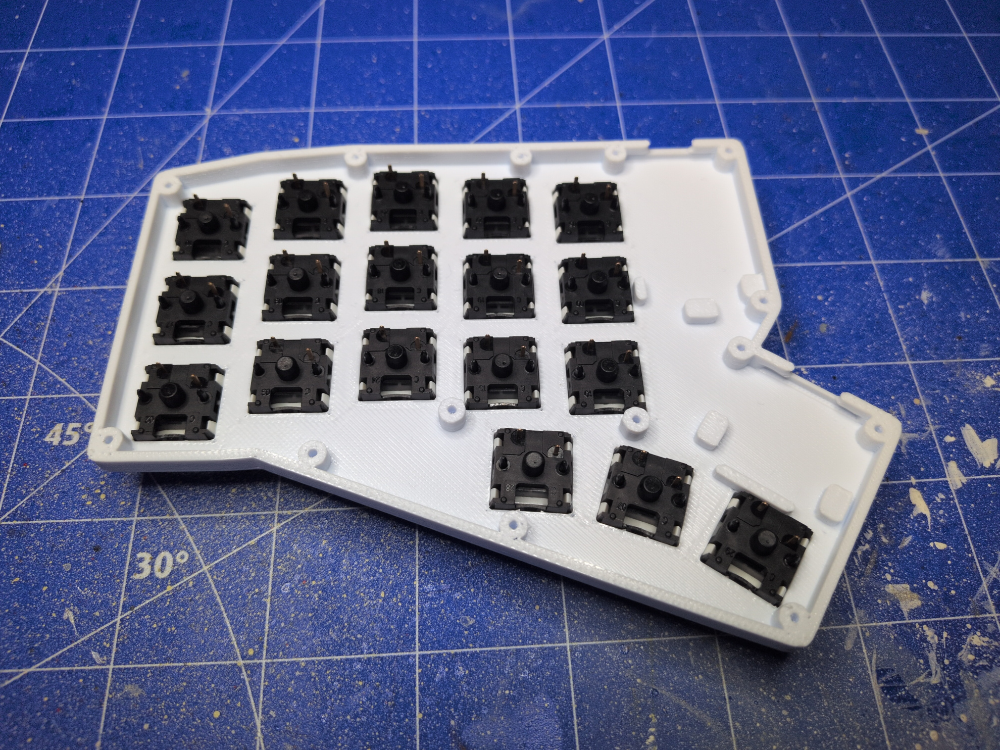

## 2. Add diodes as rows

Attach diodes to one of the pins for each switch and solder them together to form a row.

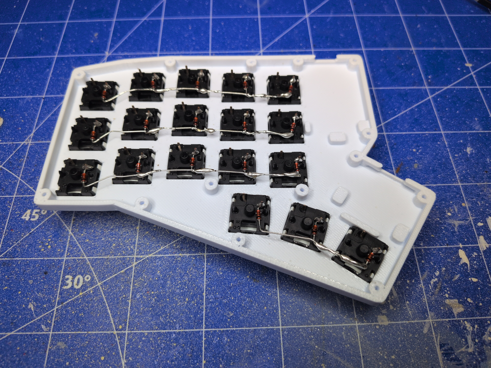

## 3. Prepare wires

With the exceptions of the thumb cluster the distance of the switch pins is the same so the wires can be prepared in a batch. To connect the 5 columns of the three rows ten wires are required per half. So 20 wires can be prepared. 

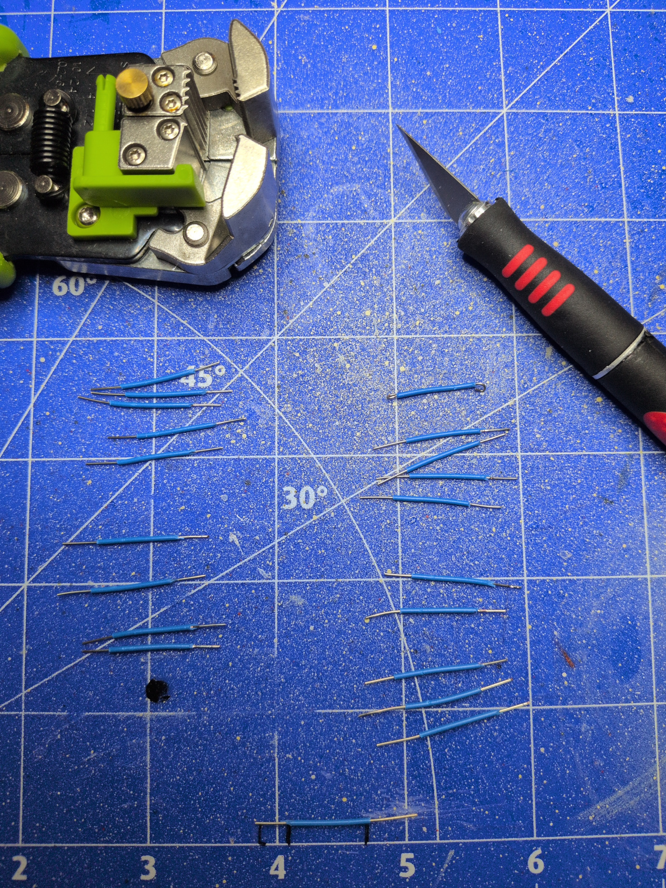

## 4. Column wire

Connect the columns with the wire.
 
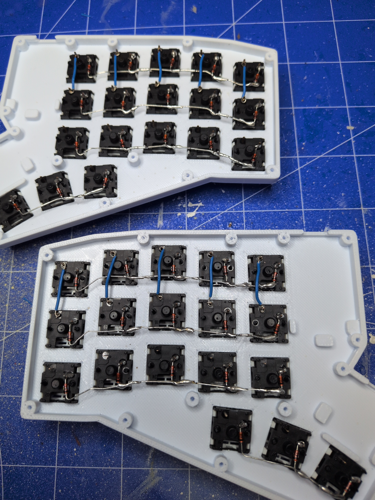

## 5. Prepare USB-C breakout

A USB-C cable is reversible but the pins are not symetrical. VCC and GND wires are symmetrical connected but the data wires are not. To have the third wire for the serial connection reversible two of the data wires must be interconnected. I opted for the D+ pair DP1/DP2.

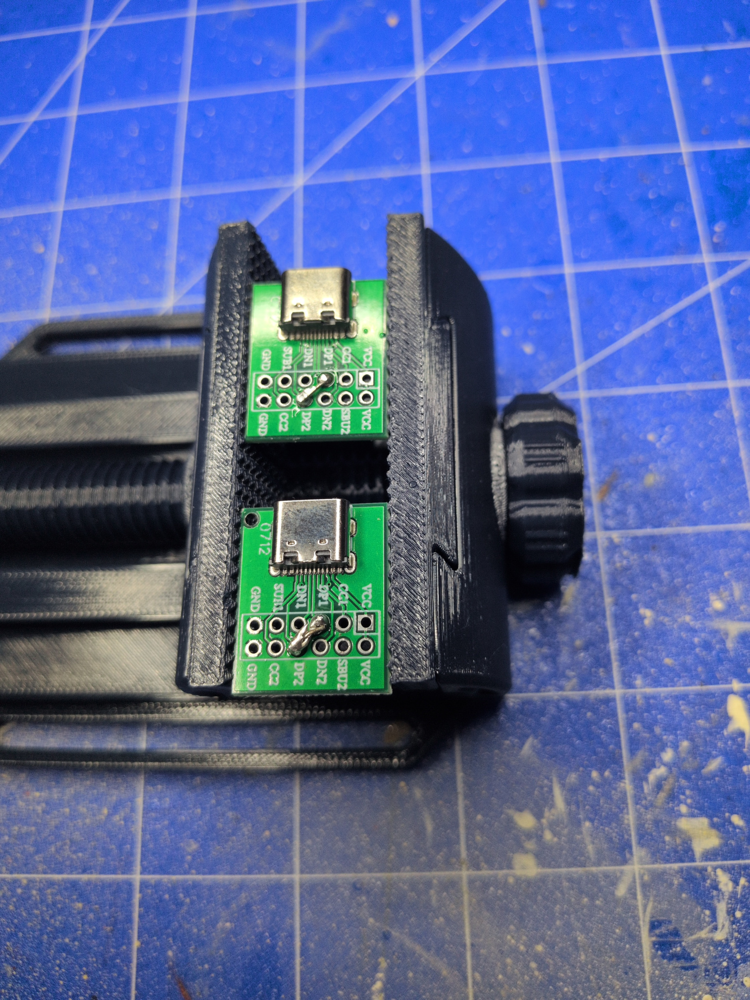

## 6. Controller

Next step is to flash the two controller to make sure they are ok before starting to solder wires to it.
Then place them in the case and use a little bit of hot glue to hold them in place. Same for the prepared USB-C breakout boards.

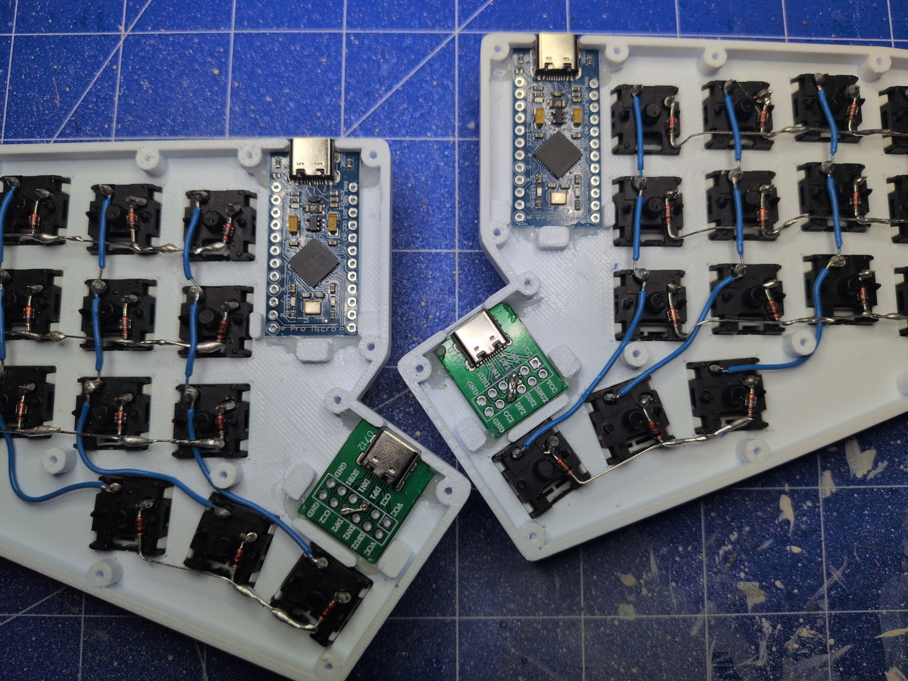

## 7. Column wiring

Nest I solder the columns to the controller.

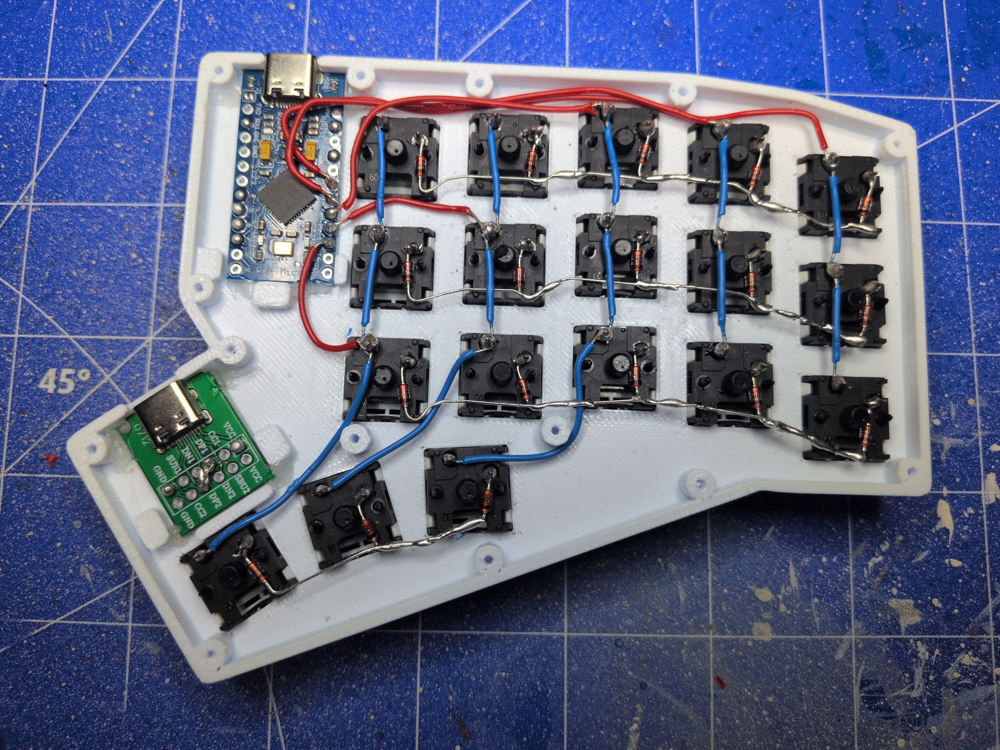

## 8. Fully wired

And after the columns the rows and the wires for the serial interconnection.

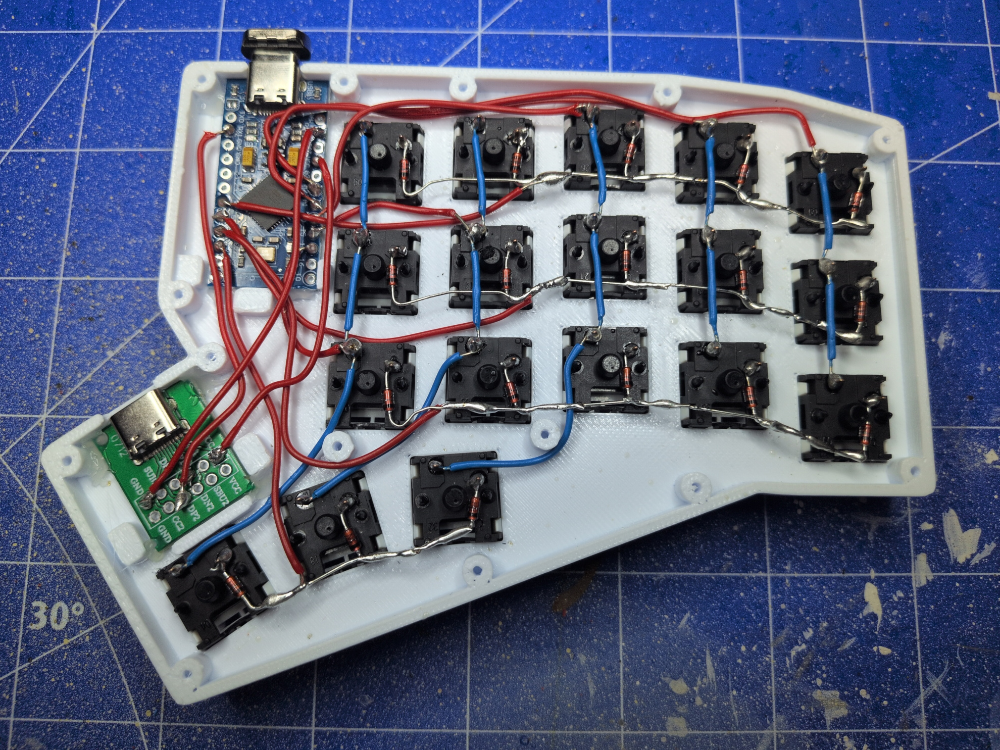

## 9. Testing

Now it is time to test the keyboard half by connecting it to a computer and use an editor or wev to check all keys work. When everything is ok I use hot glue to make sure the switches stay in place.

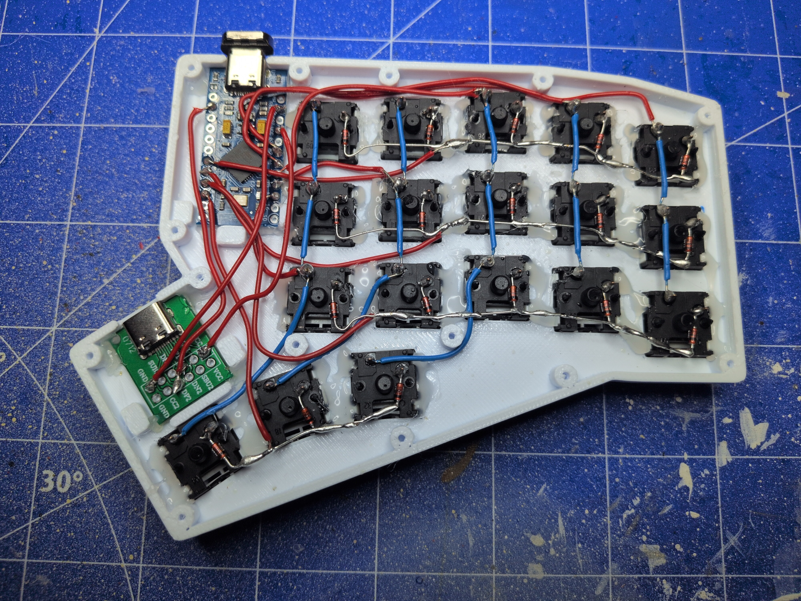

## 10. Both wired

Repeat all for the second half. 

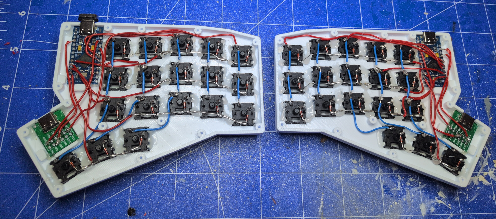

## 11. Fully assembled

Fully assembled with keycaps.

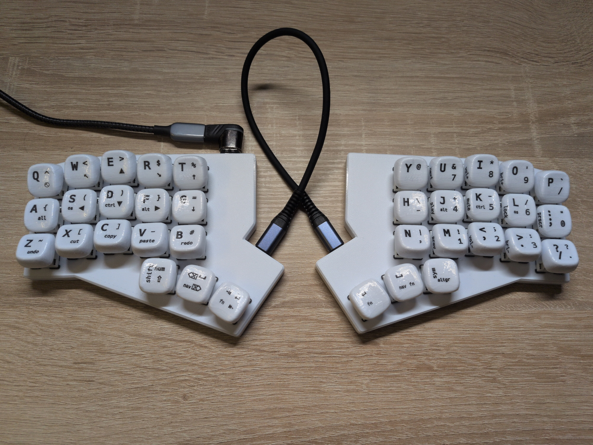
